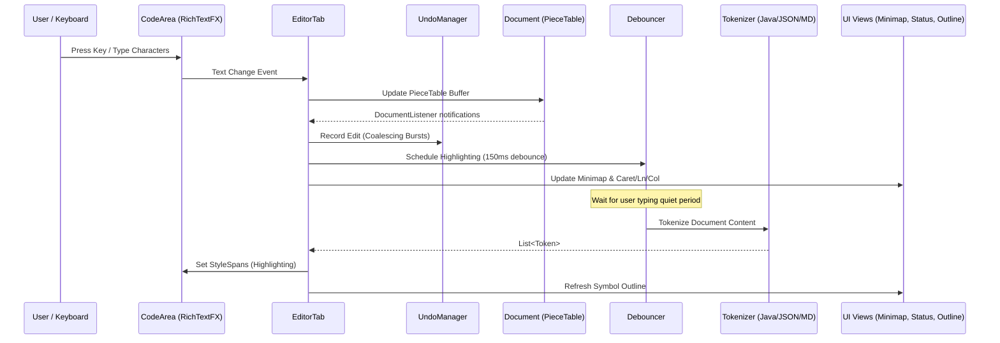

# NovaEdit Architecture & Design Specification

## 1. Architectural Overview & Strict Layering

NovaEdit adheres to a strict downward-pointing layered architecture. Core domain logic does not depend on or import JavaFX, allowing the editor core to remain completely UI-independent and easily testable.

```
+-------------------------------------------------------------+
| Presentation Layer (JavaFX 21, CSS Theming, RichTextFX)     |
|   - MainWindow, TabManager, StatusBar, ToolBarFactory       |
|   - FileExplorerPanel, SearchPanel, GitPanel, OutlinePanel  |
|   - FindReplaceBar, CommandPalette, SettingsDialog          |
+-------------------------------------------------------------+
                              |
                              v
+-------------------------------------------------------------+
| Controllers & Application Services                          |
|   - CommandRegistry, Keymap, EventBus, Debouncer            |
|   - FindReplaceService, ProjectSearchService                |
|   - GitService (JGit), DiffService (java-diff-utils)        |
|   - SnippetEngine, CompletionProvider, MacroRecorder        |
+-------------------------------------------------------------+
                              |
                              v
+-------------------------------------------------------------+
| Core Domain (Pure Java, No UI Imports)                      |
|   - TextBuffer (Interface), PieceTable, LineIndex           |
|   - Document, DocumentListener, LineEnding, EncodingInfo    |
|   - Caret, Selection, MultiCursorModel                      |
|   - EditCommand (InsertCommand, DeleteCommand, CompoundEdit)|
|   - UndoManager (Grouped typing burst coalescing)           |
|   - Tokenizer (JavaLexer, JsonLexer, XmlLexer, Markdown)   |
+-------------------------------------------------------------+
                              |
                              v
+-------------------------------------------------------------+
| Infrastructure & IO Layer                                   |
|   - FileService (50MB Safe Streaming, Charset Detection)    |
|   - EncodingDetector (juniversalchardet + BOM)              |
|   - FileWatcher (java.nio.file.WatchService Virtual Threads)|
|   - AutoSaveService (~/.novaedit/backup)                    |
|   - SettingsStore & SessionManager (Jackson JSON)           |
|   - PluginLoader (java.util.ServiceLoader SPI)              |
+-------------------------------------------------------------+
```

---

## 2. Text Buffer Architecture: PieceTable & LineIndex

### 2.1 The Piece Table
NovaEdit employs a **Piece Table** data structure (`com.novaedit.core.buffer.PieceTable`) implementing `TextBuffer`:
- **Original Buffer**: Immutable buffer holding the initial file content loaded from disk.
- **Add Buffer**: Append-only `StringBuilder` where all inserted text sequences are appended.
- **Piece Sequence**: An ordered list of `Piece` descriptors:
  ```java
  public record Piece(BufferType bufferType, int start, int length)
  ```
- **Insert Operations**: Instead of copying entire strings, inserting appends the new text to the add buffer and inserts a new piece into the list, splitting existing pieces if the insertion occurs mid-piece. Sequential typing coalesces adjacent append pieces into a single piece.
- **Delete Operations**: Deletions split piece boundaries and remove the slice without moving or modifying the underlying string buffers.

### 2.2 LineIndex
To support instantaneous `(line, column) <-> offset` mappings, `LineIndex` maintains a sorted index of line-start offsets. Lines with LF (`\n`), CRLF (`\r\n`), and legacy CR (`\r`) are supported:
- **`offsetOfLine(line)`**: $O(1)$ direct array lookup.
- **`lineOfOffset(offset)`**: $O(\log N)$ binary search lookup.

---

## 3. Edit-to-Render Event Flow



1. **Keystroke / Input**: User types in `CodeArea`.
2. **Buffer Synchronization**: `EditorTab` updates `Document.getBuffer()` (`PieceTable`).
3. **Undo Grouping**: `UndoManager` checks if consecutive characters were typed within 500ms; if so, it coalesces them into a single undo step.
4. **Debounced Lexing**: Typing triggers `Debouncer`, which waits 150ms after the last keypress before invoking the active `Tokenizer` on a virtual thread.
5. **Virtual Rendering**: `RichTextFX` receives `StyleSpans` only for visible viewport paragraphs, achieving smooth 60 FPS performance even on large documents.

---

## 4. Concurrency & Performance Model

- **UI Thread**: Exclusively handles JavaFX rendering, mouse/keyboard events, and layout.
- **Virtual Threads (`Executors.newVirtualThreadPerTaskExecutor`)**: Used for background I/O operations including:
  - Project file search (`ProjectSearchService`)
  - File watching (`FileWatcher` via `WatchService`)
  - Git repository scanning (`GitService`)
  - Crash recovery backups (`AutoSaveService`)
- Results are safely marshalled back to the UI via `Platform.runLater`.
- Large file safeguard: Documents over 20 MB automatically disable heavy decorators (minimap preview) to maintain fluid typing latency.

---

## 5. Plugin Architecture

NovaEdit exposes a clean, modular Java SPI via `java.util.ServiceLoader`:
```java
public interface Plugin {
    String getId();
    String getName();
    String getVersion();
    void onLoad(PluginContext context);
    default void onUnload() {}
}
```
Plugins can register new commands in `CommandRegistry`, show toasts, interact with the `EventBus`, and query active document text.
